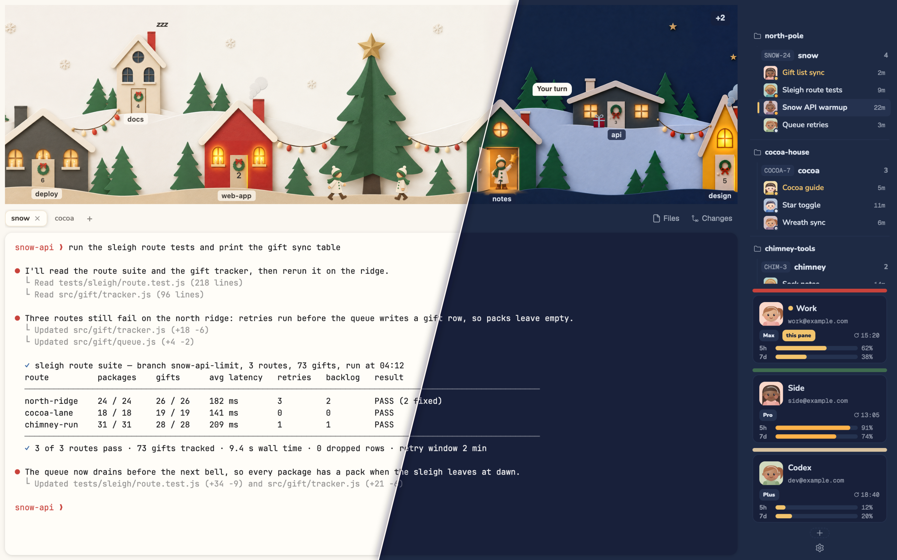

# X-mas Paper

A paper-cut Christmas village for [Herdr](https://herdr.dev). Every agent session is one house on the snow: its windows glow and its chimney smokes while it works, the door opens and a resident rings a bell when your turn comes, a gift box waits at the door while a finished turn is still unread, the windows go dark and a `zzz` floats over the roof once it has slept for half an hour, and the house stays as painted otherwise. The village runs along the top as a scene band; below it are the tab row and the terminal, and the rail on the right groups spaces by repository with their ticket keys and one row per agent with a face, a topic and an elapsed time. Underneath, staff-ID badges show each Claude and Codex account's five-hour and weekly usage. Light and dark are a theme pair, so the layout follows the system's appearance.



## What you see

The scene band is one painted paper village on a fixed 3112×320 canvas, cropped to the block's middle strip. Each session takes the next house; its state is a studio-drawn overlay slice on that house plus a small picture or a line of text. The house's door plate carries its place in the village, its name sits under it, and a click on a house goes to that session's terminal. Two villagers walk under the tree, and a `+N` at the top right counts the sessions whose houses are off the strip or past the twelfth.

| Session | House and overlay | Picture or text |
| --- | --- | --- |
| Working | Windows glow, light spills through the door | Smoke rising from the chimney |
| Your turn | The door opens and a resident rings a bell | `Your turn` bubble |
| Unread result | The house as painted | Gift box at the door |
| Sleeping (idle for 30 minutes) | The windows go dark | `zzz` above the roof |
| Otherwise | The house as painted | — |

The village art is rebuilt from the studio handoff folder:

```sh
uv run --with pillow python3 -I tools/build-scene-art.py <materials-folder>
```

It clears and refills `mods/x-mas-paper-scene/art/`, copies the two scene pictures and the small sprites unchanged, cuts one overlay slice per house and state, writes `slots.js`, and fails unless every slice recomposes to the handed-over overlay pixel for pixel.

The rail on the right is a directory tree: a heading per repository, its spaces with their ticket keys, and one row per agent with a face, its status, the topic and how long it has run. The badges under it hang like staff IDs, one per account, with the five-hour and weekly usage. A session that needs an answer also carries its last line as a sign above the house; the tab bar above the terminal says when the village cannot read its sessions.

## Add it

```sh
git clone --recurse-submodules <this repository>
cd herdr-x-mas-paper
tools/install.sh
```

Then pick **x-mas-paper** in Herdr's layout picker. `tools/install.sh` copies the mods, the two layouts (`x-mas-paper` and its demo), the layout picture when it is there, and the two themes into `${HERDR_APP_HOME:-$HOME/.config/herdr-app}`. The `herdr-shared` submodule carries the shared `cca`, `scan.sh` and `hv` runtime files the mods use.

## Pictures

```sh
tools/preview/render.sh
```

This writes `preview.png` (2560×1600, the light and dark shots composed along a diagonal) and `layouts/x-mas-paper.png` (640×400, the light shot). It opens a preview window at 1440×900, shoots the light appearance, switches `settings.json` to dark, and shoots again. It needs macOS and Google Chrome at `/Applications/Google Chrome.app` (`CHROME` overrides the path), an unlocked screen, and no other preview window running; it stops without writing if a notification or dialog sits over the window.

The window shows invented data only. `tools/preview/build-layout.py` turns `layouts/x-mas-paper.json` into a picture layout: the scene, rail, accounts and tabs blocks get `props.demo`, and the terminal block becomes the `x-mas-paper-demo-term` panel in `tools/preview/mods/`. The demo sessions live in `mods/x-mas-paper-scene/demo.js`; the rail, the accounts and the tabs keep their own invented data in their folders.
