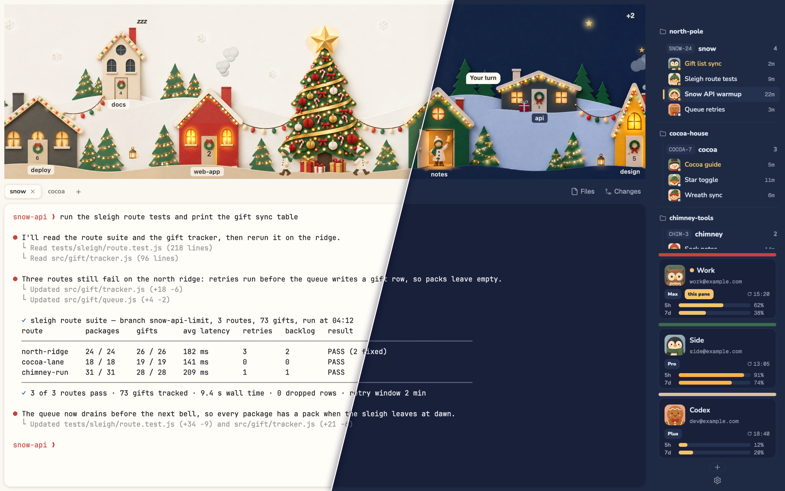

# X-mas Paper

A paper-cut Christmas village for [Herdr](https://herdr.dev). The top of the window is one painted village band: every agent session is a house on the snow, its windows glow and three smoke puffs climb from its chimney while it works, the door opens and a resident rings a bell when your turn comes, a gift box waits at the door while a finished turn is unread, the windows go dark and a `zzz` floats over the roof once the session has slept for half an hour, and otherwise the house stays as painted. Two villagers walk under the tree, three bloom layers make the village breathe, and the selected house wears four red-paper corner brackets. Below the band sit one 30 px tab row and one terminal pane with a 30 px header. The 248 px rail on the right groups spaces under their repositories, puts a ticket-key chip on the spaces that carry one and gives every agent a row with a face, a status dot, a topic and an elapsed time, and stands staff-ID badges for the Claude accounts along its bottom. Light and dark are a theme pair, so the whole thing follows the system appearance.



## What you see

The window has no titlebar, the traffic lights sit at [14, 16], the window background is the theme's `chrome` (`#FBF8F2` light, `#1E2A44` dark) and terminal text is inset [14, 12]. There is no gap between the two columns. The left column (weight 1) pads 8 px on every side with 8 px gaps; the right rail is a fixed 248 px (draggable between 200 and 320). The scene band is therefore `window width − 264` px wide: 248 px of rail plus the left column's two 8 px paddings.

The theme pair names `x-mas-paper-light` and `x-mas-paper-dark`, and Herdr swaps them with the system appearance. Light: background `#FFFDF8`, foreground `#3A3530`, chrome and canvas `#FBF8F2`, surface `#FFFDF8`, border/hover/selected `#F1E6D2`, muted `#D9C3A0`, accent and cursor `#C8423B`. Dark: background `#18203A`, foreground `#DCE3EE`, chrome and canvas `#1E2A44`, surface `#18203A`, border/hover/selected `#25324F`, muted `#8A94A8`, accent and cursor `#F2C46D`. The terminal ANSI palettes follow the same paper/ink idea (`#C8423B`, `#3F6B4F`, `#a8611a`, `#3a68a6` … in light; `#FFB24A`, `#8FBF88`, `#F2C46D`, `#8FB0D8` … in dark). No font is named by the layout; the rail, tabs, pane header, accounts and editor name `Nunito` for UI text and `Geist Mono` for keys, counts and times, and the scene draws its own labels in the system UI font and `Helvetica`.

Top to bottom, left to right.

- **Scene band** (320 px tall, min 240, max 320, `window_drag`, radius 10, block background `surface`). It draws one studio-painted village (`scene_light.png` / `scene_dark.png`) on a fixed 3112 × 320 logical-px canvas, scaled by the larger of height/320 and width/3112 so it is never squashed, centred horizontally and bottom-aligned: a narrow window shows the middle of the village and a short one cuts the sky. The band paints its own ground first (`#F7F4EE` light, `#15181E` dark).
  - **Houses.** Twelve painted houses. Session 1 takes house 7, and the next sessions fill outward in the order 7, 6, 8, 5, 9, 4, 10, 3, 11, 2, 12, 1. Each seated house carries:
    - a **door plate** printed with its place in the village (1, 2, 3 …), centred on the painted door plate, digit size 62 % of the plate's height capped at 13 logical px, weight 600, ink `#3A3530`;
    - a **name chip** under the house: 11 logical px, weight 600, system UI font, padding 3 × 6, radius 4, background `#FFFCF6B8` with ink `#3A3530` in light and `#16203CCC` with ink `#DCE3EE` in dark, one line cut at 120 px with an ellipsis and clamped 4 px inside the band;
    - **state overlays**: a studio slice per state laid over the house — working (windows glow, light spills through the door), turn (the door opens, a resident rings a bell), sleep (the windows go dark) — each fading in and out over 400 ms;
    - a **`gift` sprite** at the door while the turn is an unread result;
    - a **`Your turn` bubble** above the house while it is your turn: 11 px, weight 600, `Helvetica`, padding 5 × 7, radius 8 with a 2 px bottom-left tail, `#FFFCF6` on ink `#3A3530`, a soft shadow in light only;
    - **`zzz`** above the roof while the session sleeps: 12 px italic weight 600, `#3A3530` light / `#DCE3EE` dark.
  - **Lights and motion.** A string-light layer sits above the state slices, so the bulbs stay lit whatever the house is doing. Three bloom overlays breathe between opacity 0 and 1 on 2.2 s, 2.9 s and 3.6 s there-and-back loops.
  - **Smoke** rises from the chimney of every working house: up to three puffs per chimney, each a `puff_p1`–`p4` sprite that starts small (scale 0.5–0.65), low, at opacity 1, and then climbs 34–52 px, drifts −10…10 px sideways, grows to 1.3–1.7× and fades out over 1.5–3.2 s with ease-out movement and an ease-in fade. Each chimney's first round starts at a random point inside one round.
  - **Walkers.** Two villagers cross the lane under the tree (logical x 1420–1690, floor 314), first after 600 ms and then every 9 s, turning at the lane ends; their two frames alternate every 500 ms. They face right or left by swapping sprite groups, not by mirroring.
  - **Selection.** The selected house wears four 20 × 20 logical-px red-paper corner brackets that fade in over 400 ms while the other houses' stay at opacity 0.
  - **Overlays on the band.** A `+N` chip at top 10, right 12 counts sessions whose house is off the visible strip plus every session past the twelfth (13 px, weight 700, padding 5 × 8, radius 5, `#FFFCF6CC` / `#16203CCC`). The search query, when typing, shows in a chip immediately left of it. While the band holds the keyboard it draws one line of keys at the top centre (`←→ Select · ↩ Go to · Space Waiting · ⇧Space Unread · ⌫ Read · ? Keys · Esc`, 12 px, weight 600, `Helvetica`, padding 5 × 10, radius 5, kept clear of the top-right chips) and a 2 px accent ring with radius 10 around the whole block. A notice (the read mark `Marked as read · ⌘Z Undo`, "No unread result", or "No session is waiting for you") takes the line's place.
- **Tab row** (30 px, `window_drag`). Its tab items are 26 px tall, 9 px side padding, 6 px gaps, radius 8, `Nunito` 12 px (weight 700 active, 600 otherwise). The active tab takes the theme's `surface` fill, a 1 px `border` line and a small shadow; hover is `#E9DEC8` light / `#26334F` dark. A tab shows its program icon when there is one, its name (max 170 px, truncated), a spinning 12 px spinner while it is working, a 6 px dot in the danger colour when blocked (`#C8423B` light, `#FFB24A` dark) and in the ok colour when done (`#3F6B4F` light, `#F2C46D` dark), and a close button on the active one. A `+` button opens Herdr's `new-menu` popup. When the village cannot read its sessions or a read mark is undoable, a pill (28 px tall, radius 14, up to 360 px) appears at the right with the message and a `Retry` or `Undo` button.
- **Terminal** (fills the rest of the column, block background `chrome`, radius 12, shadow `sm`). The pane itself uses the theme `background`, a 2 px `accent` focus border, radius 12 and 8 px gaps. Its 30 px header draws the program icon (14 px), the agent's name or title (max 260 px), a branch chip (`⎇ branch`, 11 px `Geist Mono`), the folder with the home path shortened to `~`, a 12 px spinner while working, a `Needs you` chip in the danger colour at 15 % (`#C8423B26` light, `#FFB24A26` dark) while blocked and a 7 px dot in the ok colour when done (`#3F6B4F` light, `#F2C46D` dark); on hover it grows split-right, split-down, zoom/unzoom and close buttons.
- **Rail** (248 px, resizable 200–320, `window_drag`, `chrome` background). Three blocks, top to bottom:
  - **Space tree** (fills the height above the badges, scrolls, 44 px top padding). One 28 px heading per repository (12 px folder glyph, repository name in `Nunito` 12 px weight 800), a 1 px vertical guide at x 23 behind the rows, and a 1 px separator between groups. Each space is a 28 px row (10 px left, 8 px right, 6 px gaps, radius 8): a ticket-key chip when the space or its agents carry one (10 px `Geist Mono`, `#F1E6D2` / `#25324F` fill), the space name in `Nunito` 13 px weight 800, a hollow 8 px ring when a shell there has idled 10 minutes, and the agent count in 11 px (or `–`). The active space's block gets the theme's `block` fill, radius 10 and 2 px vertical padding. Below it, one 28 px row per agent (8 px gaps, radius 6): a 22 px face with an 8 px status dot at its bottom-right, the topic in `Nunito` 12 px (weight 700 and the turn colour when the agent needs you), and the elapsed time in 10 px `Geist Mono`. Status dot colours in light are turn `#C8423B`, working `#3F6B4F`, unread `#D9C3A0`, asleep `#3A353099`; in dark `#F2C46D`, `#FFB24A`, `#DCE3EE`, `#DCE3EE99`. The focused agent gets the `focus` fill and a 3 px accent bar at its left. Spaces whose terminal folder is in no git repository sit in a group under a dashed-box `No repo` heading, and a Slack-thread bot's sessions get a group of their own headed by that bot's label. Ticket keys look like `SNOW-24`; which key shapes, repository prefixes and thread bot the rail recognises is set per person (see Built from).
  - **Account badges** (300 px in the layout, then resized by the mod itself; 8 px gaps, 8 px bottom padding, stacked from the bottom). One staff-ID badge per Claude account and model: a 6 px lanyard in the account's colour (`#C8423B`, `#3F6B4F`, `#D9C3A0`, `#3A3530` by account order), then a 110 px card (radius 10, 1 px `border`, `card` fill, 10 px padding, 6 px gaps) with a 38 px face, the name in 13 px `Nunito` weight 700 (a `●` in the accent when this is the account new sessions start under), the email in 10 px `Geist Mono` (or `not signed in`), a 9 px plan pill, a `this pane` pill in the accent for the focused Claude Code pane's account, a reset time with a 10 px reset glyph, and one meter row per rate-limit window (10 px label, 7 px bar with a 4 px radius, 10 px percentage — the danger colour from 90 %, the warn colour from 70 %). A badge is `rail width − 32` wide, clamped 44–288 px; under 150 px it falls back to a 52 px face-only card.
  - **Buttons** (52 px): two 32 px buttons (radius 9, 14/15 px glyphs, muted, hover to the theme's hover fill) — New space (dashed border) and Settings.
- **Overlays.** Clicking a badge opens the accounts popup: a raised panel 460 px wide, radius 10, 1 px border, 6 px padding, scrolling, with an `Agents` header and a 40 px row per installed agent; under Claude Code come its account rows (52 px head, then a 22 px usage bar per window), an add-account row and a 32 px start-command row; under Codex come its accounts and add row; then a `Not installed:` line, a `Custom commands` section with its own rows and add row, and, when a Claude session is focused, a `Continue this session as` section that resumes it under another account or model in a new pane. The popup's height is the sum of its rows, capped at 860 px. Right-clicking a space or a tab opens Herdr's own `menu` popup.

## How it behaves

Every session's picture is one of five. Claude Code reports its own status (`waiting`, `busy`, `shell`, `idle`), the band works out `busy` or `idle` for Codex and Gemini, and Herdr reports its other agents as `blocked`, `working`, `done` or `idle`.

| Picture | When | House and overlay | Picture or text |
| --- | --- | --- | --- |
| Working | scan `busy` or `shell`, or a Herdr agent `working` | windows glow, light spills through the door | smoke from the chimney |
| Your turn | scan `waiting` (with any reason), or a Herdr agent `blocked` | the door opens and a resident rings a bell | `Your turn` bubble |
| Unread result | scan `idle` whose last activity has not been marked read; a Herdr agent `done` until it is marked read | the house as painted | gift box at the door |
| Sleeping | a read `idle` session whose last activity is more than 30 minutes old | the windows go dark | `zzz` above the roof |
| Otherwise | a read `idle` under 30 minutes old, or no state at all | the house as painted | — |

A `waiting` whose reason mentions permission or approval is still "your turn"; the scene does not draw a different picture for it. A finished turn counts as read once you have marked it read, or when Herdr reports its own agent on that terminal as `idle` rather than `done`.

**Scanning.** The band reads its sessions every 3 s. A failing read shows the red message with `Retry` in the tab row. Herdr agents the read does not list become houses of their own — one already claimed by a read session, or a `claude-code` one, is skipped — and each scanned session is matched to its terminal.

**The keyboard and the mouse.** Clicking a house goes to that session's terminal (and marks its unread result read). Clicking an empty spot on the band takes the keyboard, and so does Herdr's own focus landing on the block; the block also drags the window, so a press only counts as a click when it is released within 4 px of where it started. The band keeps the keyboard until it is left.

| Key | What it does |
| --- | --- |
| ← → | Select the previous / next visible house; a missing selection starts at that end; the ends wrap |
| ⌥← ⌥→ | Select the first / last visible house |
| ↩ | Go to the selected session's terminal |
| Space / ⇧Space | Go to the next session waiting for you / with an unread result, the one that has waited longest first, cycling on repeat; off-strip houses and the ones past the twelfth count too |
| ⌫ | Mark the selected unread result read (its gift goes); the notice offers `⌘Z Undo` for 6 s |
| ⌘⌫ (while searching) | Clear the whole query |
| ⌥⌫ (while searching) | Delete the last word of the query |
| typing | Search the visible house names, case-insensitive; the first match is selected as you type. Hangul typed as 2-set jamo is composed into syllables |
| ? or ⇧/ (while not searching) | Swap the key line for the whole legend |
| ⌘Z | Undo the last read mark, within its 6 s notice |
| Esc | Clear the query, then the selection, then give the keyboard back |
| ⌘[ / ⌘] | Walk back / forward through the terminals visited before (from `keys.json`); terminals that have ended are skipped |
| ctrl+opt+p | Give the band the keyboard, or give it back |

Giving the keyboard back returns it to the pane the band came from when that pane is still open, else the pane below.

**The tab bar.** A click selects a tab; dragging a tab moves it; a double-click asks Herdr to rename it; a right-click opens Herdr's tab menu; the scroll wheel steps to the previous/next tab; `+` opens the new-tab menu. Every second the bar names the tabs nobody named: a tab follows its first agent's session name (the terminal title Claude Code sets), else its folder — the basename of the git top level, `~` at home — with `-2`, `-3` … appended when the space already has that name. Names a person gave are left alone. A failed rename is retried after 10 s.

**The pane header.** A click focuses the pane. On hover, the four buttons split right, split down, zoom/unzoom and close that pane. The header reads the pane's program icon, name, branch, folder and status.

**The rail.** Every 30 s the rail works out each terminal folder's repository, then groups each space by its first terminal's folder. It keeps one repository's spaces next to each other, base checkout first, and moves them back when they drift apart. A space's ticket key and cleaned name come from the working-folder name the scene publishes, or, when no agent of that space has one, from the space's own name with its repository prefix and random suffixes dropped. The heading spells the whole repository name. Clicking a space selects it, and the tab it stands for when the tree splits one space into one row per tab; clicking an agent row focuses its pane. Right-clicking a space opens Herdr's space menu. The rail's own keyboard (`↑` `↓` `↩` `Space`, only when the block has focus) moves a 1.5 px accent ring and selects. Hovering highlights a row; the active space is drawn as a raised block. Agents are ordered blocked, working, done, idle. Elapsed times and the 10-minute shell-idle ring count from when this rail copy last saw the status or the shell's turn change — Herdr gives no timestamps. The bottom two buttons run `space.new` and `app.settings`.

**The accounts.** The rail reads the accounts every 30 s, then again whenever the focused pane's Claude Code process changes. The focused pane's account is lifted to the top of the badge stack and wears `this pane`. A badge's tooltip is the account, its windows, `this pane` and, for the default account, `new sessions`. Clicking any badge opens the popup; inside it, ↩ or Space on an agent row starts that program, on an account row makes it the account new sessions start under (the popup stays open), `o` opens the highlighted row in a new pane, and Esc closes. Adding an account or custom command, renaming, and the start command all go through `cca`. The badges' block resizes itself to `accounts × (badge height + 8) + 8`, so the 300 px in the layout is only the first size.

**Motion.** Only opacity, width, height, left and top animate (400 ms fades for houses' state slices, brackets, gift and bubbles; 9000 ms linear lane crossings for the walkers; 500 ms frame alternation; the three bloom loops; the puffs' per-round transitions). Selection, gift, bubble and `zzz` changes appear and disappear by opacity; colour changes are instant.

## Built from

- `layouts/x-mas-paper.json`: root `row` with `"preview": "layouts/x-mas-paper.png"`, `theme: {light: "x-mas-paper-light", dark: "x-mas-paper-dark"}`, `background: "chrome"`, `titlebar: "none"`, `traffic_lights: [14, 16]`, `terminal_padding: [14, 12]`, and two children:
  - `work` column (`resizable: false`, `padding: 8`, `gap: 8`): `scene` block (`px 320`, `min 240`, `max 320`, `window_drag: true`, `radius: 10`, `background: "surface"`, `mod: x-mas-paper-scene`), `tabs-row` block (`px 30`, `window_drag: true`, `mod: x-mas-paper-tabs`), and `main` block (`tab: "active"`, `pane.header` = `{mod: x-mas-paper-pane, reveal: "always", height: 30, position: "top"}`, pane `background: "background"`, `focus: {width: 2, color: "accent"}`, `radius: 12`, `gap: 8`, `lone: true`; block `background: "chrome"`, `radius: 12`, `shadow: "sm"`);
  - `rail` column (`px 248`, `min 200`, `max 320`, `resizable: true`, `window_drag: true`, `background: "chrome"`): `rail-spaces` (mod `x-mas-paper-rail`, no props), `rail-accounts` (`px 300`, mod `x-mas-paper-accounts`, `props {role: "rail"}`), `rail-buttons` (`px 52`, mod `x-mas-paper-rail`, `props {role: "buttons"}`).
- `layouts/x-mas-paper-demo.json`: the same tree with `props {demo: true}` on the scene block only. The preview pictures do not use this file: `tools/preview/build-layout.py` builds their layout from `x-mas-paper.json`, adding the demo props to the scene, rail, accounts and tabs blocks and replacing the terminal block with `x-mas-paper-demo-term`.
- `themes/x-mas-paper-light.json` and `themes/x-mas-paper-dark.json`: the palette above (background, foreground, selection, cursor, a 16-colour ANSI list, and the `accent`, `chrome`, `canvas`, `surface`, `border`, `selected`, `hover`, `muted` roles).
- `mods/x-mas-paper-scene/` (`mod.json`: `{place: "none", title: "X-mas paper scene", focusable: true}`): the band. `main.js` polls the scan, keeps the session model, publishes shared state, owns the command loop and the keyboard; `model.js` is the pure state/scan/frame/placement maths; `scene.js` draws every layer; `keys.js` is the pure key decisions (seat stepping, wait targets, search, visit history, `press:` specs); `hangul.js` composes and uncomposes 2-set jamo; `demo.js` is eight invented sessions; `slots.js` is generated (canvas, fill order, walker lane, twelve houses with their plate/label/door/smoke/gift/bubble/select anchors, blink periods, smoke-puff ranges, sprites and the per-house overlay rectangles). It answers the commands `toggle`, `focus`, `back`, `forward` and `press:<json key spec>`, and publishes `x-mas-paper-scene` (`{places, counts}`), `x-mas-paper-scene.notice` and reads back `x-mas-paper-scene.notice-act`.
- `mods/x-mas-paper-rail/` (`{place: "none", title: "X-mas paper rail"}`): one mod, two roles — `spaces` (default; the tree) and `buttons` (the bottom pair). `main.js` reads `spaces()`, `agents()`, `terminals()`, `panes()` and `shared("x-mas-paper-scene")`; `site.js` holds the space-name patterns (neutral defaults; the install replaces it with `${XMAS_SITE_JS:-~/.config/herdr-x-mas-paper/site.js}` when that file exists); `demo.js` is the invented tree for the picture.
- `mods/x-mas-paper-accounts/` (`{place: "none", title: "X-mas paper accounts", overlay: {kind: "popup", width: 260, height: 300}}`): roles `rail` and `chip` (the chip is a 26 px head pill with gauges; this layout places only `rail`), and the default `menu` popup that `openOverlay({mod: "x-mas-paper-accounts", kind: "popup", width: 460, height})` opens, plus the 340 × 340 add-command form (`props.mode: "add"`). `main.js` parses `cca --porcelain`, drives the popup, and starts panes with `pane.split`; `codex-usage.mjs`, `usage-api.mjs`, `models.mjs`, `usage-tap.sh` and `cca` are vendored from `herdr-shared`.
- `mods/x-mas-paper-tabs/` (`{place: "none", title: "X-mas paper tabs", cloned_from: {name: "tabs", version: "0.1.12"}}`): Herdr's shipped tabs mod, changed so an unnamed tab shows its agent's session name (else its folder), the bar sits flush in its row, and names are set through `tab.rename`.
- `mods/x-mas-paper-pane/` (`{place: "none", title: "X-mas paper pane header"}`): Herdr's shipped pane mod with the header's top corners rounded to 12 px. Props from the app: `{pane, terminal}`.
- `mods/x-mas-paper-editor/` (`{place: "none", title: "X-mas paper editor", focusable: true}`): the editor pane `hv <file>` opens. Header 36 px, file name and shortened folder, dirty dot, `Code`/`Preview` for markdown, `Open as tab`, `Save`; `⌘S` saves, a stale banner offers `Reload`, and it saves only onto the text it read. Commands: `save`, `focus`.
- Herdr built-in mods used: `menu` (space and tab right-click menus) and `new-menu` (the tab row's `+`).
- `herdr` functions used: scene — `exec`, `appHome`, `run`, `props`, `shared`, `setShared`, `theme`, `agents`, `terminals`, `panes`, `focused`, `nextCommand`; rail — `spaces`, `agents`, `terminals`, `panes`, `exec`, `run`, `openOverlay`, `props`, `shared`, `theme`; accounts — `agents`, `terminals`, `focused`, `run`, `exec`, `props`, `appHome`, `openOverlay`, `closeOverlay`, `knownAgents`, `shared`, `theme`; tabs — `spaces`, `panes`, `run`, `exec`, `home`, `openOverlay`, `theme`, `window`, `shared`, `setShared`, `layout`, `props`; pane — `panes`, `props`, `run`, `theme`, `home`; editor — `home`, `props`, `readTextFile`, `writeTextFile`, `settings`, `theme`, `nextCommand`, `focused`, `panes`, `run`.
- Commands run: `pane.focus`, `pane.split`, `pane.close`, `pane.go`, `space.select`, `space.new`, `space.move`, `tab.select`, `tab.new`, `tab.rename`, `tab.move`, `tab.prev`/`tab.next`, `tab.close`, `layout.resize`, `layout.show`, `layout.hide`, `layout.select`, `window.minimize`, `window.maximize`, `window.close`, `app.settings`.
- Shared state: `x-mas-paper-scene` (the scene's places and state counts, read by the rail), `x-mas-paper-scene.notice` (the tab row's message and its `Retry`/`Undo` action) and `x-mas-paper-scene.notice-act` (the action token the tab row writes back). The tabs mod also reads `workspace.panels`, and the accounts mod reads `new-menu.agents` as a fallback for the installed-agent list.
- Programs: the scene runs `exec("sh", [appHome + "/mods/x-mas-paper-scene/scan.sh"])` every 3 s; `scan.sh` is a `sh` wrapper around embedded `python3` (it prints a `meta` error line and exits 0 when `python3` is missing), reads session records, transcripts, Codex rollouts, Gemini chats, deadhd state, page alerts and process environments, and writes only ledger and identity caches under `${TMPDIR:-/tmp}/herdr-pulse`. The rail runs `git -C <cwd> rev-parse --path-format=absolute --git-common-dir --show-toplevel` per distinct terminal folder every 30 s. The tabs mod runs `git -C <cwd> rev-parse --show-toplevel` when naming a tab after its folder. The accounts mod runs `cca --porcelain [pid]`, `cca launch`, `cca launch set`, `cca use`, `cca codex use`, `--porcelain-add`, `--porcelain-add-codex`, `--porcelain-add-model` and `--porcelain-rename`, and starts panes with `sh -lc` launch lines that set `CLAUDE_CONFIG_DIR` / `CCA_ACCOUNT`; `cca` reads and writes account files, usage records under `~/.local/state/herdr-tower/usage/`, Codex limits through `codex-usage.mjs` and the custom-model list through `models.mjs`, and at most every 5 minutes `usage-api.mjs` fetches the usage endpoint with the keychain token. `hv` and `hv-open` are the editor launcher and the Herdr Open applet's route.
- Art: `mods/x-mas-paper-scene/art/` — `scene_{light,dark}.png`, `lights_{light,dark}.png`, `blink_{1,2,3}_{light,dark}.png`, `select_{tl,tr,bl,br}_{light,dark}.png`, `gift_{light,dark}.png`, `walker_{left,right}_{1,2}_{light,dark}.png`, `puffs/puff_p{1..4}_{light,dark}.png` and 72 `state_{working,turn,sleep}_{light,dark}_h{1..12}.png` slices; plus 24 face pngs in `mods/x-mas-paper-rail/faces/` and another copy in `mods/x-mas-paper-accounts/faces/`.
- `tools/build-scene-art.py` rebuilds `art/` and `slots.js` from the studio handoff folders: `uv run --with pillow python3 -I tools/build-scene-art.py <base-folder> [<override-folder> ...]`. Each file is read from the last folder that has it; the canvas must be `[3112, 320]` at scale 2, the scene, lights, blinks and state images must be 6224 × 640, and the select brackets 40 × 40. It clears `art/`, copies the flat pictures, cuts each house's `slot_x` band out of each state image (trimming transparent rows on even picture px), and fails unless every slice composites back to the masked overlay pixel for pixel, no state slice covers the tree band (x 2925–3372) and a later folder changes the scene only inside that band. It writes `slots.js` (only the sprites whose files it copied) and replaces both 24-face sets, checking 128 × 128.
- `tools/install.sh` copies the six mods, both layouts, `layouts/x-mas-paper.png` when present and both themes into `${HERDR_APP_HOME:-$HOME/.config/herdr-app}`, removes each target mod folder first, restores the execute bits of `cca`, `usage-tap.sh`, `hv` and `hv-open`, then, for the accounts, scene and editor mods, runs `$HERDR_SHARED/tools/link-installed.sh` (the `herdr-shared` checkout, default this repo's `vendor/herdr-shared` submodule) against the mod when the shared home `${HERDR_SHARED_HOME:-$HOME/.local/share/herdr-shared}` exists, skipping a mod folder that resolves inside this checkout (it keeps its vendored copies). When `${XMAS_SITE_JS:-~/.config/herdr-x-mas-paper/site.js}` exists it copies that file over the installed rail `site.js`. It then runs `herdr-app check` on every mod, and never edits `keys.json`: when the file is missing or has no `layout:x-mas-paper` section it prints `tools/keys-section.txt` and says where the section goes.
- `tools/keys-section.txt`:
  ```json
  "layout:x-mas-paper": {
    "ctrl-alt-p": "x-mas-paper-scene.toggle",
    "cmd-[": "x-mas-paper-scene.back",
    "cmd-]": "x-mas-paper-scene.forward"
  },
  "layout:x-mas-paper-demo": {
    "ctrl-alt-p": "x-mas-paper-scene.toggle",
    "cmd-[": "x-mas-paper-scene.back",
    "cmd-]": "x-mas-paper-scene.forward"
  }
  ```
- Pictures: `tools/preview/render.sh` writes `preview.png` (2560 × 1600, the light and dark shots composed along a diagonal) and `layouts/x-mas-paper.png` (640 × 400, light). It needs macOS and Google Chrome (`CHROME` overrides the path), an unlocked screen, no other preview window and nothing shown over the window; it starts a 1440 × 900 preview window at a temp home, waits for two shots 1.5 s apart to differ, switches `settings.json` to dark, shoots again, stops the window and composes with headless Chrome. `tools/preview/build-layout.py` turns the layout into the picture layout (demo props on the scene, rail, accounts and tabs; the terminal block becomes `x-mas-paper-demo-term`; the toast becomes `x-mas-paper-demo-toast`). `tools/preview.sh` starts/stops/shoots the preview window and poses the scene with `tools/preview.sh do x-mas-paper-scene.press:{...}`.
- `tests/` (13 test files, 163 tests, run with `node --import ./tests/stubs/register.mjs --test tests/`) covers the scene model and keys, the rail's space names, the faces, tabs, pane, editor, accounts (including the vendored `cca` helpers), install and install-keys behaviour, the preview tooling, and that the vendored runtime files match the `herdr-shared` submodule.

## Watch out

- **The band is a crop, not a fit.** The canvas is fixed at 3112 × 320 logical px and only 12 houses exist. At 320 px of height the scale is 1 until the band is wider than 3112 px, so a normal window shows the middle of the village: sessions seated further out are still counted in `+N` and still reachable by Space/⇧Space, but not by ←/→ or a click. A narrower window shows less of the strip, and the block's height may shrink from 320 to 240 px, which moves the crop as well. `placeSessions` never shrinks a house.
- **The blink loops have no phase.** `loop` animates there and back (the period is "there and back"), and gpui exposes no phase or start offset. The studio's 0 / 1.0 / 2.1 s offsets are therefore dropped: all three bloom layers start together and only drift apart through their different periods. Do not try to re-create the offsets with a delay — the loop API has none.
- **Smoke is a timer plus transitions, not one animation.** The kit animates only opacity, width, height, left and top, and a transition runs from the values of the previous render to the new ones. So a round is a brand-new element (its id carries the round number) drawn at its start values, then moved to its end values 34 ms later by property transitions; a 200 ms tick starts new rounds whose duration, rise, drift, scale and sprite were rolled fresh. Copying this with a fixed CSS keyframe loses the per-round variety; reusing one element reuses its id and the transition does not restart.
- **The walkers' wrapper id carries the scale.** A resize draws a new element at its pose instead of sliding it across the lane over 9 s; keep that if you rebuild it.
- **Every state slice of every house is drawn from the first frame.** Visibility is opacity only, so twelve houses × three states are in the element tree for the current mode even when the village is empty. That is what makes the 400 ms cross-fade work; adding elements per state change makes them flash.
- **ctrl+opt+p, ⌘[ and ⌘] need the `layout:x-mas-paper` section of `keys.json`.** Herdr only delivers a mod's keys through the `layout:<name>` section, and `tools/install.sh` never writes that file — it prints `tools/keys-section.txt` instead. While the band holds the keyboard the keys.json binding no longer arrives, so the band handles ctrl+opt+p itself; Herdr's own focus landing arrives as the command `focus`.
- **The read mark is stored by ack key, not by session.** The ack key includes the last-activity second, so any new scan activity makes the session unread again, and the key set is pruned to live sessions on every refresh. Read keys live in `localStorage` under `paper.scene.read`. The Undo lives exactly as long as its 6 s notice; a reload forgets the undo but not the read set.
- **Elapsed times and the shell-idle ring are this view's memory.** Herdr reports no start or last-activity time for agents, so the rail and the scene count from when that copy of the mod first saw the status (or the shell's turn) change. A reload of the mod resets them, and a status that never changes keeps counting from the first sighting.
- **The rail rewrites Herdr's space order.** Every 30 s it reads the repository of each terminal folder, then calls `space.move` to put one repository's spaces together, base checkout first. Each desired order is tried once; if a person reorders spaces by hand, the rail can move them back on its next pass.
- **The rail's headings are always wide.** `WIDE_W` is 120 px of block width, but the layout's rail cannot go below 200 px, so the "first word" narrow heading is unreachable here; every heading spells the whole repository name.
- **The tab row is not compact.** Neither layout passes `props.compact`, so it is the full 170 px-label shape and draws the Files and Changes panel buttons (when `workspace.panels` lists them) although this layout has no `panel` block for them to show. A build that wants the compact bar must pass `compact: true` and add the panel block.
- **The accounts block resizes itself.** `layout.resize` on `rail-accounts` sets it to `accounts × (height + 8) + 8`, so the layout's 300 px is a starting size only; a build that removes the block id or the role breaks the badges' space. Badge width follows the rail width (248 ⇒ 216 px, full badges), and under 150 px the badge drops to a 52 px face card.
- **This layout shows no head gauges.** The accounts mod's `chip` role (the 26 px head pill and its 44 px gauges) exists but no block in either layout uses it; the only accounts surface is the rail's badges and their popup. Do not expect a head gauge from this layout.
- **The accounts popup cannot resize after opening.** The menu is fixed at 460 px wide and its height is computed from the rows that will be drawn (capped at 860 px), so a section added without updating `menuHeight` clips; the add-command form is a second popup at 340 × 340 (`props.mode: "add"`). The menu is the only place `cca`'s add, use, rename and launch subcommands are reached, and those in turn use `codex-usage.mjs`, `usage-api.mjs` and `models.mjs`; none of it works without the runtime files the install links or copies.
- **`scan.sh` needs `python3`.** Without it the scan prints a `meta` error and the tab row shows a red message with `Retry`; the band then has no scanned sessions and only shows Herdr agents. Scanned sessions are live Claude Code, Codex and Gemini CLI sessions; shell sessions come from Herdr's own agents.
- **The scan's status words are not Herdr's.** A scan record says `waiting` / `busy` / `shell` / `idle` (Claude Code's words, passed through; `busy`/`idle` computed for the other CLIs); Herdr's agents say `blocked` / `working` / `done` / `idle`. `model.js` translates both; mixing them up turns "unread result" into "asleep".
- **The plate ink is fixed.** The door-plate digit is `#3A3530` in both modes while the name chip switches ink per mode; a rebuild that gives the plate the chip's ink pair changes how it reads in dark.
- **Fonts are named but not bundled.** `Nunito` and `Geist Mono` are named by the rail, tabs, pane, accounts and editor; without them Herdr's fallback is used and the rail's numbers and key chips shift. The scene draws its own labels in the system UI font and `Helvetica`, and the editor's code view uses the app's settings font.
- **The preview pictures are window shots.** `render.sh` needs macOS, Google Chrome and an unlocked screen; it refuses when a preview window is already running or a notification or dialog sits over it, and it catches a covered window by requiring two shots 1.5 s apart to differ (the village moves). The pictures must show invented data only; demo rows live in the mods' `demo.js` files and in the tabs and demo-terminal mods.
- **The install replaces the installed mod folders.** `tools/install.sh` removes `mods/<name>` under the app home before copying, so a hand edit in the installed copy is lost. It links runtime files only when the `herdr-shared` checkout (`$HERDR_SHARED`, default this repo's `vendor/herdr-shared` submodule) carries `tools/link-installed.sh` and the shared home (`$HERDR_SHARED_HOME`, default `~/.local/share/herdr-shared`) exists; it skips a mod folder that resolves inside this checkout, and otherwise the vendored copies stay.
- **`hv` needs the editor mod by name.** It derives the mod id from its own folder (`*-editor`) and calls `herdr-app` (or `HERDR_APP`); it is not bound in the layout, and a renamed mod folder breaks it.

## Done when

- `node --import ./tests/stubs/register.mjs --test tests/` passes: 163 tests covering the five states, the frame maths, the slots and overlay files, the keyboard decisions, the faces, tabs, pane, editor, accounts parsing, install and keys behaviour, and the vendored files.
- `tools/install.sh` copies the six mods, both layouts, `layouts/x-mas-paper.png`, both themes and prints a `herdr-app check` pass line for each mod; with no `layout:x-mas-paper` section it prints the section instead of touching `keys.json`.
- Picking **x-mas-paper** in the layout picker shows the village band, the 30 px tab row, the terminal with its header, and the rail with its space tree, account badges and two buttons; the layout picker shows the 640 × 400 picture.
- A Claude Code session appears as a named house on the band within one 3 s scan; while it works its chimney puffs and its windows glow; a waiting session opens its door and shows `Your turn`; a finished unread one gets a gift box that goes away when the house is clicked; a session idle for more than 30 minutes shows `zzz` over dark windows.
- Clicking a house focuses that session's terminal; clicking empty band area draws the key line and the 2 px accent ring and takes the keyboard; ←/→ move the brackets, ↩ visits, Space jumps to the oldest waiting session, ⇧Space to the oldest unread one, ⌫ marks a result read (the tab row offers `Undo` for 6 s), Esc clears the query then the selection then gives the keyboard back.
- With the `layout:x-mas-paper` section in `keys.json`, ctrl+opt+p toggles that keyboard ownership, and ⌘[/⌘] walk back and forward through visited terminals.
- The rail groups spaces under repository headings, puts the ticket key in a chip, lists each agent with a face, status dot, topic and elapsed time, and focuses a pane when a row is clicked; the account badges sit at the bottom, widen with the rail, and open the popup when clicked.
- The tab row shows the active tab selected, names unnamed tabs after their sessions or folders, selects on click, moves on drag, renames on double-click and opens the new-tab menu from `+`.
- Headless checks: `herdr-app check mods/x-mas-paper-scene` (and the other five mods) prints its pass line; `tools/preview/render.sh` writes `preview.png` at 2560 × 1600 and `layouts/x-mas-paper.png` at 640 × 400, and refuses with a message while the screen is locked or a preview window is running.
- Switching the system appearance redraws both palettes: the band picks its scene and ink by the theme's background luma, and the rail, tabs, pane, accounts and editor pick their token set the same way.
